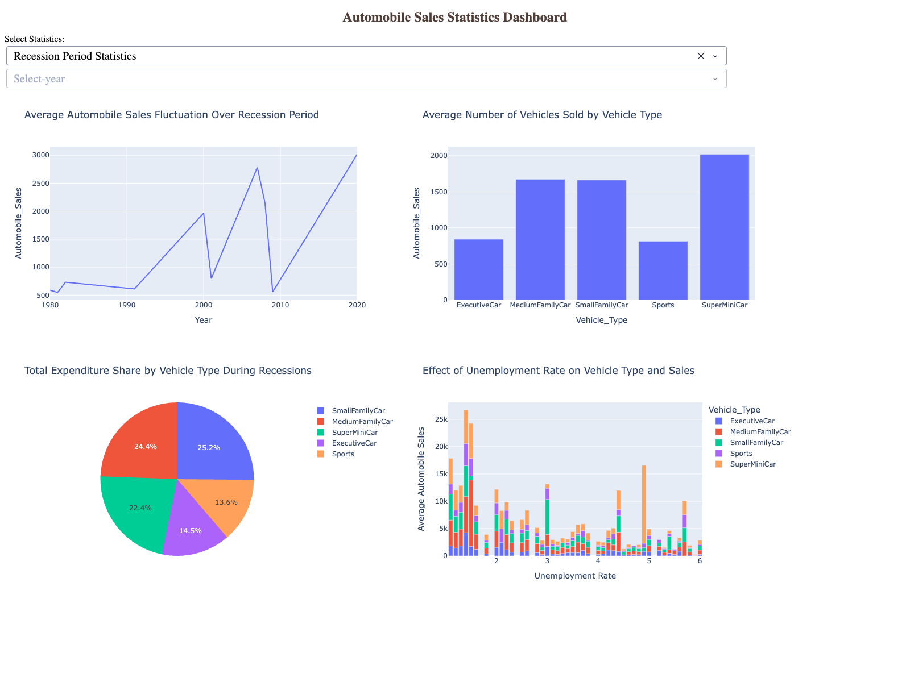
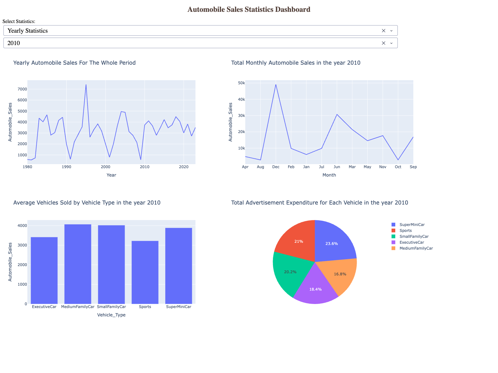

# 🚗 Automobile Sales Analysis & Interactive Recession Dashboard

[](https://www.python.org/)
[](https://plotly.com/dash/)
[](https://pandas.pydata.org/)
[](https://seaborn.pydata.org/)
[](https://opensource.org/licenses/MIT)

An end-to-end data visualization and interactive business intelligence dashboard project analyzing historical trends in automobile sales across economic recession and non-recession periods (1980–2023).

Developed as the Capstone Final Project for **Data Visualization with Python**, part of the **IBM Data Science Professional Certificate**.

---

## 📌 Table of Contents
- [Executive Overview](#-executive-overview)
- [Dataset Architecture](#-dataset-architecture)
- [Key Analytical Insights](#-key-analytical-insights)
- [Interactive Dashboard Architecture](#-interactive-dashboard-architecture)
- [Dashboard Previews](#-dashboard-previews)
- [Project Structure](#-project-structure)
- [Installation & How to Run](#-installation--how-to-run)
- [Technologies Used](#-technologies-used)
- [Acknowledgments](#-acknowledgments)

---

## 📊 Executive Overview

Economic downturns significantly disrupt consumer sentiment, purchasing power, and automotive market dynamics. The primary goal of this project is to analyze how historical recessions (e.g., 1981–1982, 1991, 2000–2001, 2008–2009) impacted automobile sales for **XYZAutomotives**, and to deliver an interactive web dashboard for executives to drill down into yearly performance and recession trends dynamically.

### Key Objectives:
1. **Historical Trend Analysis:** Analyze fluctuations in vehicle sales across four decades against macroeconomic indicators (GDP, Unemployment, Consumer Confidence).
2. **Vehicle Category Sensitivity:** Identify which vehicle segments (SuperMiniCar, SmallFamilyCar, MediumFamilyCar, ExecutiveCar, Sports) exhibit the highest vulnerability or resilience during recessions.
3. **Advertising Expenditure ROI:** Assess advertising allocation strategies during recessions vs. growth periods.
4. **Executive Dashboarding:** Build a responsive, multi-page interactive web application using **Plotly & Dash** with stateful callbacks and conditional control flow.

---

## 📋 Dataset Architecture

The historical automobile dataset captures monthly sales and economic indicators from **1980 to 2023**:

| Feature Variable | Data Type | Description |
| :--- | :--- | :--- |
| `Date` | Datetime | Date of observation |
| `Year` / `Month` | Integer / String | Extracted year (1980–2023) and month |
| `Recession` | Binary (0 / 1) | Economic recession indicator (1 = Recession, 0 = Normal) |
| `Automobile_Sales` | Float | Total sales volume / units sold |
| `GDP` | Float | Per-capita GDP in USD |
| `unemployment_rate` | Float | Monthly civilian unemployment rate (%) |
| `Consumer_Confidence` | Float | Consumer sentiment confidence index |
| `Seasonality_Weight` | Float | Monthly weighting factor accounting for seasonal trends |
| `Price` | Float | Average vehicle selling price (USD) |
| `Advertising_Expenditure`| Float | Total marketing / advertisement expenditure |
| `Vehicle_Type` | Categorical | Vehicle class (`SuperMiniCar`, `SmallFamilyCar`, `MediumFamilyCar`, `ExecutiveCar`, `Sports`) |
| `City` | Categorical | Regional sales office location |

---

## 🔍 Key Analytical Insights

### 1. Recession Impact on Sales Volume
* **Severe Drop:** Average vehicle sales plummet by over **55–65%** during declared recession years compared to non-recession periods.
* **Annotated Peaks & Troughs:** Notable drops correspond directly to the early 1980s recession, the 1991 downturn, and the 2008 Great Financial Crisis.

### 2. Segment Vulnerability & Consumer Substitution
* **High-End Fragility:** Luxury (`ExecutiveCar`) and performance (`Sports`) vehicles suffer the largest proportional collapse in demand during recessions.
* **Shift to Economy:** Budget-friendly vehicles (`SuperMiniCar`) demonstrate stronger relative resilience, capturing over **30%** of total unit volume during economic downturns due to consumer downsizing and cost sensitivity.

### 3. Advertising Spend Dynamics
* **Procyclical Budgeting:** XYZAutomotives heavily slashed advertising during recessions, allocating over **75%** of its lifetime marketing budget to expansionary periods.
* **Targeted Allocation:** When marketing budgets were deployed during recessions, spend was concentrated primarily on low-cost economy and compact family cars.

### 4. Unemployment & Price Elasticity
* **Inverse Correlation:** Sales exhibit a sharp negative slope against rising unemployment, with accelerated decline once unemployment exceeds **3.5%**.
* **Price Sensitivity:** Higher vehicle prices strongly correlate with steep sales volume drops during recessions, emphasizing affordability over luxury features.

---

## 🖥️ Interactive Dashboard Architecture

Built with **Plotly Dash**, the interactive dashboard provides a 2x2 grid reporting layout powered by reactive callbacks:

```
                  ┌──────────────────────────────────────────────┐
                  │    Automobile Sales Statistics Dashboard     │
                  └──────────────────────┬───────────────────────┘
                                         │
                 ┌───────────────────────┴───────────────────────┐
                 ▼                                               ▼
     [Select Statistics Dropdown]                      [Select Year Dropdown]
     • Recession Period Statistics                     • Disabled during Recession mode
     • Yearly Statistics                               • Enabled (1980–2023)
                 │                                               │
                 └───────────────────────┬───────────────────────┘
                                         ▼
                           Reactive Callback Handler
                                         │
        ┌────────────────────────────────┴────────────────────────────────┐
        ▼                                                                 ▼
 ─── Recession Report (2x2) ───                                    ─── Yearly Report (2x2) ───
 1. Sales Fluctuation (Line)                                       1. Sales Over Full Period (Line)
 2. Sales by Vehicle Type (Bar)                                    2. Total Monthly Sales (Line)
 3. Ad Spend Share by Type (Pie)                                   3. Vehicles Sold by Type (Bar)
 4. Unemployment Rate Impact (Grouped Bar)                         4. Ad Spend per Vehicle (Pie)
```

### Dashboard Features:
* **Conditional Input Enabling/Disabling:** Selecting *Recession Period Statistics* automatically disables the year dropdown, preventing invalid state combinations.
* **Dynamic Title & Axis Formatting:** Each plot dynamically renders titles, axis legends, and color scales based on the selected year.
* **Responsive Flexbox Layout:** Clean 2-column, 2-row layout engineered for desktop and executive presentations.

---

## 📸 Dashboard Previews

### 1. Recession Period Statistics Report
Shows historical automobile sales trends, vehicle breakdown, advertising expenditure distribution, and unemployment rate impact during economic recessions:



### 2. Yearly Statistics Report (Selected Year: 2010)
Drills down into whole-period trends, monthly seasonality for the selected year, vehicle segment performance, and annual marketing distribution:



---

## 📁 Project Structure

```bash
Automobile-Sales-Recession-Dashboard/
├── README.md                      # Comprehensive project documentation
├── requirements.txt               # Python package dependencies
├── .gitignore                     # Git exclusion rules
├── app.py                         # Production Plotly Dash application
├── notebooks/
│   └── Automobile_Sales_Analysis.ipynb # Full EDA with Matplotlib, Seaborn & Folium
├── data/
│   └── us-states.json             # GeoJSON boundaries for regional choropleth mapping
└── images/
    ├── recession_report_dashboard.png  # High-res recession report screenshot
    └── yearly_report_dashboard.png     # High-res yearly report screenshot
```

---

## 🚀 Installation & How to Run

### 1. Clone the repository
```bash
git clone https://github.com/Phantom-Pain9/Automobile-Sales-Recession-Dashboard.git
cd Automobile-Sales-Recession-Dashboard
```

### 2. Create and activate a virtual environment
```bash
python3 -m venv venv
source venv/bin/activate    # On Windows: venv\Scripts\activate
```

### 3. Install required packages
```bash
pip install -r requirements.txt
```

### 4. Launch the Interactive Dashboard
```bash
python app.py
```
Open your browser and navigate to `http://127.0.0.1:8050/` (or the terminal-specified port).

### 5. Run the Exploratory Data Analysis Notebook
```bash
jupyter notebook notebooks/Automobile_Sales_Analysis.ipynb
```

---

## 🛠️ Technologies Used

* **Language:** Python 3.8+
* **Dashboard & Web:** Plotly, Dash (Dash Core Components, Dash HTML Components)
* **Data Manipulation:** Pandas, NumPy
* **Data Visualization:** Matplotlib, Seaborn, Folium (Choropleth mapping)
* **Dataset Management:** Requests, GeoJSON

---

## 📜 Acknowledgments

* **IBM Data Science Professional Certificate** — Coursera
* Course: *Data Visualization with Python* (DV0101EN)
